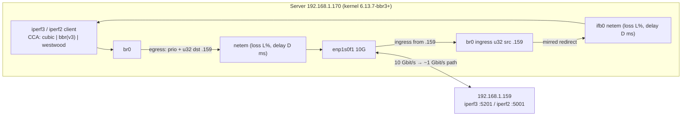
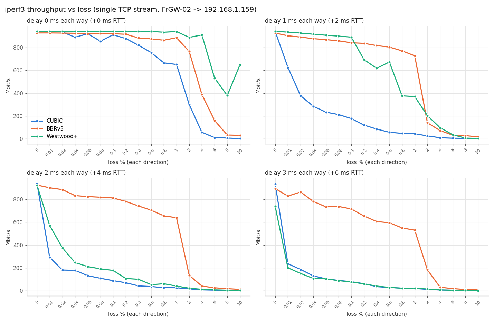
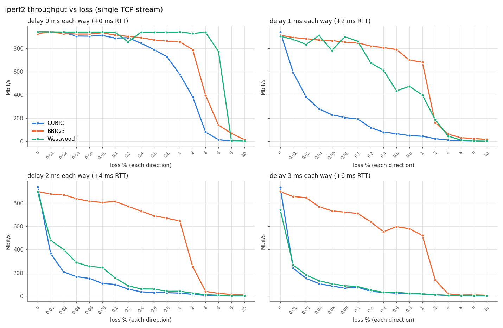
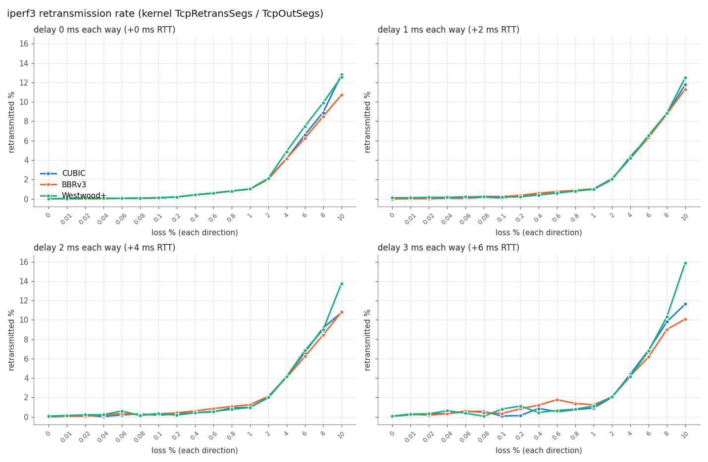

# BBRv3-CUBIC-Westwood-Comparison
TCP Congestion Control Comparison: CUBIC vs. BBRv3 vs. Westwood

## 1. Summary

| Condition | CUBIC | BBRv3 | Westwood+ |
|---|---|---|---|
| No loss, no delay | 942 Mbit/s | 928 Mbit/s | 942 Mbit/s |
| No loss, +6 ms RTT, mean RTT seen by TCP | 7.9 ms | **5.8 ms** | 7.0 ms |
| 0.1 % loss, +4 ms RTT | 89 Mbit/s | **813 Mbit/s** | 178 Mbit/s |
| 1 % loss, +6 ms RTT | 20 Mbit/s | **530 Mbit/s** | 21 Mbit/s |
| 2 % loss, +2 ms RTT | 26 Mbit/s | 141 Mbit/s | **203 Mbit/s** |
| 4 % loss, no delay | 57 Mbit/s | 388 Mbit/s | **910 Mbit/s** |

(iperf3, single stream, 10 s; loss and delay applied in **both** directions.)

1. **BBRv3 wins clearly when there is RTT and random loss up to 1 %.** With 1–3 ms of added one-way delay and 0.01–1 % loss, BBRv3 keeps 530–903 Mbit/s. Over the same range CUBIC drops to 20–626 Mbit/s and Westwood+ to 21–935 Mbit/s. At +4 ms and +6 ms RTT, BBRv3 is 3–26× faster than CUBIC.
2. **BBRv3 has a cliff between 1 % and 2 % loss.** This comes from its design: BBRv3 treats a per-round loss rate above `bbr_loss_thresh` = 2 % as congestion and cuts `inflight_hi`. Above 2 %, BBRv3 behaves much more like a loss-based CCA, though it is still 2.5–15× faster than CUBIC.
3. **CUBIC is the most loss-sensitive.** Its throughput follows the Mathis rule (~MSS/(RTT·√p)). With +2 ms RTT, just 0.01 % loss cuts it from 941 to 626 Mbit/s.
4. **Westwood+ does unusually well at near-zero RTT (0 and 1 ms delay).** After a loss its bandwidth estimate sets cwnd ≈ BWE·RTTmin instead of halving it, and at sub-millisecond RTT it refills quickly. At 2–3 ms delay it gives up that advantage and performs much like CUBIC.
5. **With no loss, BBRv3 queues the least.** Its mean RTT is 30–40 % lower than CUBIC's (1.6 vs 2.7 ms with no added delay). The cost is about 1.5 % less throughput (927 vs 942 Mbit/s), which is expected from its periodic ProbeRTT/drain phases.
6. **iperf2 confirms the iperf3 results.** It shows the same ordering and the same cliffs; see `throughput_iperf2.png` and the `iperf2_Throughput` sheet.

## 2. Network topology

```
                      Server (Debian 13, kernel 6.13.7-bbr3+, Intel Core i3-N305, 8 cores, 31 GiB RAM)
   ┌──────────────────────────────────────────────────────────────────────────────────────────────┐
   │  iperf3 / iperf2 client (sender, CCA under test: cubic | bbr | westwood)                     │
   │        │                                                                                     │
   │        ▼                                                                                     │
   │  br0  192.168.1.170/24 ─── EGRESS:  prio 1: ── u32 dst 192.168.1.159 ──► 1:3 netem          │
   │   │  ▲                     (loss L %, delay D ms, limit 100000)                              │
   │   │  │                                                                                       │
   │   │  └──────────────────── INGRESS: ffff: ── u32 src 192.168.1.159 ── mirred ──► ifb0 netem  │
   │   │                                                    (loss L %, delay D ms)                │
   │   ├── enp1s0f1  (Intel 82599ES, 10 Gbit/s SFP+) ── 192.168.1.159 is learned on this port    │
   │   └── enp1s0f0  (Intel 82599ES, 10 Gbit/s SFP+) ── second bridge port (not on test path)    │
   │                                                                                              │
   │  enp2s0 / enp3s0 (I226-V 2.5G, link down, 192.168.100.1/24 on enp3s0) – not used            │
   └──────────────────────────────────┬───────────────────────────────────────────────────────────┘
                                      │ 10 Gbit/s
                                      ▼
                         LAN 192.168.1.0/24 (L2)
                                      │  ~1 Gbit/s bottleneck (max goodput 941 Mbit/s)
                                      ▼
                                 192.168.1.159
                    iperf3 Server: 5201   iperf2 Server: 5001   (receiver)
```



- Baseline ping RTT Server → 192.168.1.159: **0.45 ms** (min 0.39 ms).
- The bottleneck is about 1 Gbit/s somewhere between enp1s0f1 and the receiver: all three CCAs top out at 941–942 Mbit/s, while both Server ports link at 10 Gbit/s. I don't have visibility past Server's port, so the device that limits it (switch port or receiver NIC) is not identified.
- Under load with no impairment, the RTT TCP sees rises to 1.6–2.7 ms, so there is a buffer at the 1 Gbit/s bottleneck.

## 3. Test method

### 3.1 Matrix

| Parameter | Values |
|---|---|
| CCA | `cubic`, `bbr` (BBR v3, `/sys/module/tcp_bbr/version` = 3), `westwood` |
| Loss (each direction) | 0, 0.01, 0.02, 0.04, 0.06, 0.08, 0.1, 0.2, 0.4, 0.6, 0.8, 1, 2, 4, 6, 8, 10 % |
| Delay (each direction) | 0, 1, 2, 3 ms (adds 0, 2, 4, 6 ms to RTT) |
| Tools | iperf3 3.18 (`-C <cca> -t 10 -J`) and iperf2 2.2.1 (`-Z <cca> -t 10 -e`) |
| Direction | Upload, Server → 192.168.1.159, so the CCA under test is the sender's |
| Runs | 17 × 4 × 3 × 2 tools = **408 runs**, 10 s each, 1 run per cell; **0 failed** |

The order was delay → loss → CCA → tool, so the three CCAs for each condition ran back-to-back, within about 75 s of each other.

### 3.2 tc configuration (on Server)

The impairment applies only to traffic to/from 192.168.1.159, so SSH and other traffic are unaffected.

```bash
# offloads off + one MSS per skb (see 3.3)
ethtool -K br0      tso off gso off gro off
ethtool -K enp1s0f0 tso off gso off gro off
ethtool -K enp1s0f1 tso off gso off gro off
ip link set dev br0 gso_max_segs 1

# egress
tc qdisc add dev br0 root handle 1: prio bands 3 priomap 0 0 0 0 0 0 0 0 0 0 0 0 0 0 0 0
tc qdisc add dev br0 parent 1:3 handle 30: netem limit 100000 delay 0ms loss 0%
tc filter add dev br0 parent 1: protocol ip prio 1 u32 match ip dst 192.168.1.159/32 flowid 1:3

# ingress (via IFB)
ip link add ifb0 type ifb && ip link set ifb0 up
tc qdisc add dev br0 handle ffff: ingress
tc filter add dev br0 parent ffff: protocol ip prio 1 u32 match ip src 192.168.1.159/32 \
   action mirred egress redirect dev ifb0
tc qdisc add dev ifb0 root handle 1: netem limit 100000 delay 0ms loss 0%

# per test condition
tc qdisc change dev br0  parent 1:3 handle 30: netem limit 100000 delay ${D}ms loss ${L}%
tc qdisc change dev ifb0 root       handle 1:  netem limit 100000 delay ${D}ms loss ${L}%
```

When the tests finished, everything was removed: qdiscs deleted, `ifb0` deleted, offloads back on, `gso_max_segs` back to 65535.

### 3.3 Accuracy fix: per-packet loss

My first smoke test showed a problem. With `loss 1%`, the egress netem counter reported only 0.05 % drops, and the qdisc reported 105 267 packets sent while the u32 filter matched only 5 121 skbs.

The cause: Linux TCP always builds **GSO super-packets** (≈20–44 MSS each) and segments them *after* the qdisc, even with `gso off` on the device. So netem was dropping whole 30–64 KB bursts, about 1 % of skbs rather than 1 % of packets. That gives too few, bursty loss events and overstates throughput: CUBIC got 160 Mbit/s where true 1 % loss gives 25 Mbit/s.

Setting `gso_max_segs 1` on br0 makes each skb one MSS. After that fix:
- netem drops matched TCP retransmits exactly (109 vs 109) in the check run;
- the measured loss across all runs matches the configured value (table below);
- unimpaired throughput was still 942 Mbit/s, so the CPU was not a bottleneck.

| Configured % | 0.01 | 0.02 | 0.04 | 0.06 | 0.08 | 0.1 | 0.2 | 0.4 | 0.6 | 0.8 | 1 | 2 | 4 | 6 | 8 | 10 |
|---|---|---|---|---|---|---|---|---|---|---|---|---|---|---|---|---|
| Measured egress % | 0.010 | 0.020 | 0.040 | 0.059 | 0.079 | 0.097 | 0.199 | 0.401 | 0.600 | 0.806 | 0.996 | 2.003 | 4.008 | 5.988 | 7.964 | 9.981 |
| Measured ingress % | 0.010 | 0.022 | 0.041 | 0.058 | 0.080 | 0.100 | 0.194 | 0.401 | 0.599 | 0.817 | 0.990 | 2.001 | 4.002 | 6.033 | 7.990 | 9.958 |

## 4. Results

### 4.1 Throughput (iperf3)



The x-axis lists the tested loss values at even spacing; it is not a linear scale. A log-y version is in `throughput_iperf3_log.png`.

iperf3 throughput, Mbit/s (CUBIC / BBRv3 / Westwood+):

| Loss % | delay 0 ms | delay 1 ms | delay 2 ms | delay 3 ms |
|---|---|---|---|---|
| 0     | 942 / 928 / 942 | 941 / 927 / 941 | 940 / 926 / 924 | 936 / 895 / 739 |
| 0.01  | 940 / 928 / 942 | 626 / 903 / 935 | 293 / 902 / 572 | 237 / 829 / 201 |
| 0.02  | 936 / 927 / 942 | 378 / 891 / 927 | 181 / 886 / 376 | 186 / 865 / 152 |
| 0.04  | 890 / 925 / 942 | 285 / 878 / 917 | 179 / 833 / 247 | 130 / 783 / 108 |
| 0.06  | 921 / 921 / 941 | 234 / 869 / 908 | 132 / 825 / 211 | 104 / 735 / 104 |
| 0.08  | 855 / 923 / 941 | 212 / 859 / 900 | 109 / 819 / 192 |  90 / 738 /  88 |
| 0.1   | 912 / 921 / 942 | 178 / 842 / 891 |  89 / 813 / 178 |  79 / 717 /  77 |
| 0.2   | 878 / 916 / 941 | 120 / 837 / 694 |  70 / 782 / 107 |  62 / 655 /  60 |
| 0.4   | 820 / 884 / 941 |  86 / 817 / 618 |  43 / 743 / 100 |  36 / 606 /  41 |
| 0.6   | 756 / 876 / 940 |  57 / 804 / 673 |  37 / 706 /  53 |  29 / 596 /  29 |
| 0.8   | 666 / 864 / 934 |  48 / 771 / 377 |  26 / 656 /  61 |  23 / 550 /  22 |
| 1     | 652 / 886 / 940 |  45 / 728 / 370 |  26 / 640 /  41 |  20 / 530 /  21 |
| 2     | 301 / 765 / 889 |  26 / 141 / 203 |  16 / 135 /  22 |  12 / 183 /  15 |
| 4     |  57 / 388 / 910 | 9.5 /  72 /  98 | 8.0 /  41 /  13 | 6.6 /  30 / 7.4 |
| 6     |  11 / 161 / 533 | 5.3 /  32 /  36 | 5.3 /  26 / 7.9 | 4.9 /  19 / 4.5 |
| 8     | 6.8 /  33 / 379 | 4.5 /  28 / 6.2 | 3.7 /  18 / 4.5 | 2.4 /  11 / 3.2 |
| 10    | 2.1 /  31 / 649 | 2.8 /  17 / 3.2 | 2.8 /  12 / 2.8 | 2.4 /  10 / 1.6 |

### 4.2 Throughput (iperf2, cross-check)



iperf2 shows the same ranking and the same BBRv3 cliff at 1→2 %. The two tools differ most for Westwood+ at 0–1 ms delay and ≥ 6 % loss (for example, at d=0 and 8 %: iperf3 379, iperf2 7.1 Mbit/s). Westwood+ behaves erratically in that region, and a single 10 s run is not enough to pin it down.

### 4.3 Retransmissions and RTT



- The retransmission rate is the kernel's `TcpRetransSegs/TcpOutSegs` during each run. Up to 4 % loss it follows the configured loss for all CCAs (within ±0.3 points, except Westwood+ at d=0, 4 %: 4.9 %), so no CCA is causing much self-inflicted loss. At 10 % loss, CUBIC (10.7–12.8 %) and Westwood+ (12.5–15.9 %) retransmit more than BBRv3 (10.1–11.3 %), most likely from repeated RTO-driven resends.

Mean smoothed RTT at 0 % loss (iperf3) shows how much each CCA queues:

| Added delay | CUBIC | BBRv3 | Westwood+ |
|---|---|---|---|
| 0 ms | 2.68 ms | **1.62 ms** | 2.60 ms |
| 1 ms | 4.18 ms | **2.56 ms** | 4.02 ms |
| 2 ms | 6.34 ms | **4.28 ms** | 6.00 ms |
| 3 ms | 7.91 ms | **5.78 ms** | 6.99 ms |

## 5. Interpretation

- **CUBIC** is loss-based: each loss event multiplies cwnd by 0.7. With random (non-congestive) loss, its throughput follows ~1/√p and gets worse as RTT grows. With 2 ms or more of added RTT, even 0.01 % loss costs it 33–75 % of throughput.
- **BBRv3** is model-based: it paces at the estimated bottleneck bandwidth and doesn't treat each loss as congestion. It only reacts once the per-round loss rate passes 2 %, which is why it holds up so well up to 1 % and drops sharply at 2 %. BBRv3 deliberately added that threshold to share bandwidth fairly with CUBIC; BBRv1 ignored loss almost completely.
- **Westwood+** uses its bandwidth estimate to set cwnd after a loss, instead of halving it. That works very well when RTT is tiny (0 ms delay, ~0.5–2 ms real RTT), because cwnd refills in a few hundred microseconds. Its main growth phase is still Reno-like, though, so at 4–6 ms RTT it performs no better than CUBIC.
- **In practice on this LAN:** if the path has any random loss (wireless, or a lossy/long link), BBRv3 is the best default. On a clean, very-low-RTT LAN all three reach line rate, and BBRv3 additionally keeps queues shorter.

## 6. Limitations

- **Repetitions:** one 10 s run per cell, with no repeats. Values in the steep regions are noisy, especially for Westwood+ at high loss and 0–1 ms delay, and for CUBIC at d=0. Treat single-cell differences under ~10 % as noise.
- **Flows:** single TCP flow only. Fairness between CCAs sharing the bottleneck was not tested.
- **Loss model:** random, independent loss (Bernoulli) applied to both data and ACKs. Real networks often have bursty loss, which affects the CCAs differently.
- **Offloads:** TSO/GSO/GRO were off during the tests so loss could be applied per packet. This doesn't change which CCA wins, but absolute CPU cost would differ in production.
- **Bottleneck:** the ~1 Gbit/s bottleneck and its buffer are outside Server and weren't characterised.

## 7. Files

| File | Content |
|---|---|
| `Server_CCA_comparison.xlsx` | Workbook. Sheets: README, Raw_Data (all 408 runs), iperf3_Throughput / iperf2_Throughput (pivot tables + charts per delay), iperf3_Retrans_pct, iperf3_MeanRTT_ms, iperf3_MaxCwnd_KB, BBRv3_vs_others (throughput ratios), Measured_Loss |
| `throughput_iperf3.png`, `throughput_iperf3_log.png`, `throughput_iperf2.png`, `retrans_iperf3.png` | Charts used in this report |
| `results.jsonl` | Raw per-run records (one JSON per line) |
| `cca_raw.tgz` | Raw iperf3 JSON / iperf2 text output for every run, plus runner and log |
| `runner.py` | Test runner that was executed on Server (`/root/cca_test/`) |
| `make_report.py` | Builds the xlsx and the PNGs from `results.jsonl` |

